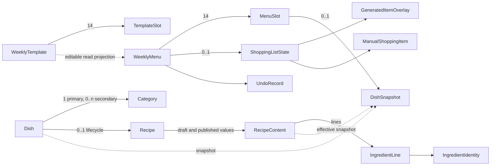

# Domain model and invariants

> V1 reference. For current F07 behavior, storage access and acceptance, see [V2.5](V2.5-SHOPPING-REMINDER.md).

Use one bounded context (menus). Implement domain types in plain Python with dates and Decimal values. Prefer small dataclasses, enums and pure functions.

## Relationships and aggregate boundaries



Weekly menu, template, dish with recipe, and separate shopping overlays are consistency boundaries. Category is seeded reference data. Canonical ingredient identity is a value rather than a registry. Cross-boundary updates that must agree share a transaction.

## Core types

| Type (module) | Properties / semantics |
|---|---|
| `MealType` (`common.py`) | `LUNCH='lunch'`, `DINNER='dinner'`; display `Dinar`, `Sopar`. |
| `MealPreference` (`catalogue.py`) | `LUNCH`, `DINNER`, `BOTH`; priority calculation only. |
| `SlotPosition` (`common.py`) | `day_index: int` 0..6 Monday..Sunday, `meal: MealType`; frozen/hashable, stable sort day then lunch/dinner. |
| `WeekStart` (`common.py`) | `value: date` Monday; `contains(date)`, `slot_date(position)`; validate rather than silently normalize supplied Monday. `for_date(date)` for current week only; previous/next ±7 days. |
| `Category` (`catalogue.py`) | `key: str`, `name_ca: str`; fixed seed keys `legumes`, `vegetables`, `cereals`, `salads`, `creams`, `soups`, `chicken`, `beef`, `pork`, `pasta`, `eggs`, `fish`, `fried`. |
| `Dish` (`catalogue.py`) | `id: int` positive stable source ID or DB-assigned new ID (never reuse); `name: str` nonblank max 200 (trim authored values; preserve imported text); `primary_category: str`; `secondary_categories: frozenset[str]`; `meal_preference`; `special_occasion: bool`; `archived: bool`; `version: int >= 1`; associated `recipe: Recipe` optional. Category memberships = union; primary not repeated. Names need not be unique (different recipes can share a name); no deduplication by display. |
| `Recipe` (`recipe.py`) | `dish_id: int` identity of owner; `draft: RecipeContent | None`; `published: RecipeContent | None`; `effective_content` returns published if present, otherwise draft, otherwise None; status `missing`, `draft`, `published` plus `has_unpublished_changes`. No separate recipe IDs necessary. |
| `RecipeContent` (`recipe.py`) | `preparation: str` (plain text, max 10000), `ingredients: tuple[IngredientLine,...]` ordered; value copy, no images; exactly two adult portions, no scaling feature. Draft may be empty; persisted lines structurally valid. Publish validation in domain. |
| `IngredientIdentity` (`recipe.py`) | Canonical key and normalized display label. Use the normalization contract below. |
| `IngredientLine` (`recipe.py`) | Named ingredient, note max 500, quantity and unit. Quantified requires a positive Decimal and unit. Explicit `al gust` has neither. A named draft line with unknown quantity may retain a known unit. Duplicate lines count. |
| `Unit` (`recipe.py`) | `GRAM='g'`, `KILOGRAM='kg'`, `MILLILITRE='ml'`, `LITRE='l'`, `UNIT='unit'`. Compatible canonical families `g`, `ml`, `unit`; exact multiply by 1000 for kg/l. `taste` is a separate aggregation discriminator, not numeric unit. |
| `WeeklyTemplate` (`template.py`) | `id=1`, `slots: mapping[SlotPosition, str | None]`, `version`; exactly all 14 positions; `set_suggestion(position, category_key)`, `clear_suggestion(position)`. |
| `SlotState` (`planning.py`) | `PENDING`, `SELECTED`, `SKIPPED`. |
| `DishSnapshot` (`planning.py`) | `dish_id`, `name`, `primary_category` and `secondary_categories` as key+name values, `meal_preference`, `special_occasion`, `recipe_status`, `recipe_content: RecipeContent | None`; copy values, no mutable alias to catalogue. No archival status dependency for historical display. |
| `MenuSlot` (`planning.py`) | `position`, nullable legacy suggestion snapshot (key+display name), unused in editable reads, `state`, `dish_snapshot: DishSnapshot | None`; selected iff snapshot exists. |
| `WeeklyMenu` (`planning.py`) | Monday identity, 14 slots, version, shopping projection version and optional undo. Domain rules receive the captured current Monday. |
| `UndoRecord` (`planning.py`) | Two positions and exact before and after values. Undo requires intact after values and eligible menu version. Rebase eligibility atomically on unrelated snapshot refresh. |
| `GeneratedKey` (`shopping.py`) | `ingredient_key: str`, `family: Literal['g','ml','unit','taste']`; stable independent of display and quantity. |
| `GeneratedItem` (`shopping.py`) | `key`, `name`, `base_quantity: Decimal | None`, `unit/family`, `notes`, occurrence provenance (slot positions) optional projection; non-quantified item quantity None. |
| `GeneratedItemOverlay` (`shopping.py`) | `key`, `last_name`, `last_base_quantity`, `adjusted_quantity: Decimal | None`, `checked: bool`; optional overlay only when needed. Absolute override in canonical units; to-taste cannot set numerical override. |
| `ManualShoppingItem` (`shopping.py`) | `id: int`, `name: str` max 120, `quantity: Decimal | None`, `unit: Unit | None`, `checked: bool`; both quantity and unit or neither (unquantified manual item). Distinct rows; no automatic merging. |
| `ShoppingListState` (`shopping.py`) | `week_start`, `version`, `overlays: mapping[GeneratedKey, GeneratedItemOverlay]`, `manual_items`; methods `add_manual`, `edit_manual`, `remove_manual`, `adjust`, `reset`, `set_checked`, `reconcile(generated)`; orphan when overlay with adjustment lacks generated key; preserve label/last base. |

### Numeric and text constraints

Each recipe contains at most 100 ingredient rows. Quantified ingredient and manual amounts are greater than zero and at most `999999999.999`. Generated totals, orphan bases and absolute overrides can reach `1399999999998600.000` in canonical units (14 slots × 100 lines × maximum input × 1000). All values allow at most three fractional digits. Use Decimal with an explicit context of at least 28 digits. Reject a value outside its range, zero, non-finite input, scientific notation, grouping separators and excess scale without rounding. The web edge accepts a single decimal comma or point. An invalid submitted amount or row count produces a field error. An invalid persisted value or aggregate overflow produces a controlled integrity error, with full rollback for writes and an unavailable view for reads.

## State machines

```
pending --assign--> selected --replace--> selected
selected --remove--> pending
pending --skip--> skipped
selected --skip (confirm)--> skipped
skipped --reactivate--> pending
selected + pending/confirmed skipped --move--> pending + selected
selected + selected --exchange--> selected + selected (different positions)
move/exchange --undo (if eligible)--> exact prior state of both positions
```

A valid same-state command is a no-op. Replacing a selected dish with the same ID, or exchanging the same position or identical snapshots, is a no-op. Successful planning edits invalidate undo. Template edits and unrelated snapshot refreshes preserve it. If a refresh changes either involved snapshot, clear undo. Stale tokens still fail for no-op requests.

## Pure rules and services

Rank by (special flag, preference mismatch, has planned date, latest planned date, dish ID). Latest means max of all persisted meal dates, including future. Never-planned dishes sort first in their tier. Query all stored occurrences; M2 exposes only the current week. Filtering any category membership deduplicates by ID.

Aggregate each selected occurrence from its snapshot. Use exact canonical conversions. Unknown draft amounts are excluded and keep that occurrence incomplete. Explicit al gust remains a separate row. Show coverage for pending slots and missing or draft recipes; skipped slots contribute nothing. Choose the minimum normalized display label by Unicode code-point order among contributing lines. Sort generated rows by canonical ingredient key, then fixed family order g, ml, unit, taste. Deduplicate and sort notes by the same code-point order. Manual amounts remain separate.

`reconcile` before/after mutations compares keys; preserve an existing checked state and absolute override for retained key; for disappearing rows, remove check-only overlay, retain adjusted overlay as orphan (set checked false); on return restore adjustment without restoring old checked state. Reset orphan removes it explicitly. Orphan can't be marked purchased as a generated item. Editing manual row preserves check if name/qty edited (visible choice of user); deleting drops it.

## Text normalization

Ingredient display labels use NFC after trimming and collapsing whitespace to single spaces. The identity key is NFC of the resulting label after casefold. Accents remain significant for ingredient matching. For example, `  SUCRE   MORENO ` and `sucre moreno` share a key, while `cafè` and `cafe` do not. Canonically composed and decomposed accents give the same key.

For dish search only, casefold both query and candidate names, apply NFD and remove Unicode `Mn` combining marks before substring matching. Trim the query. `CAFE` matches `Cafè` and its decomposed form. Preserve display text and use the same search helper in picker and catalogue.

## History and invariants

Weeks are Monday-based in Europe/Madrid and editable when their Monday is at least the captured current Monday. Apply the transaction and rollover rules in [persistence](04-persistence.md#concurrency-and-atomicity). Past reads use frozen slot values, overlays and the stored projection version. Historical results remain stable across compatible upgrades using the [history contract](04-persistence.md#historical-projection-and-upgrades).
